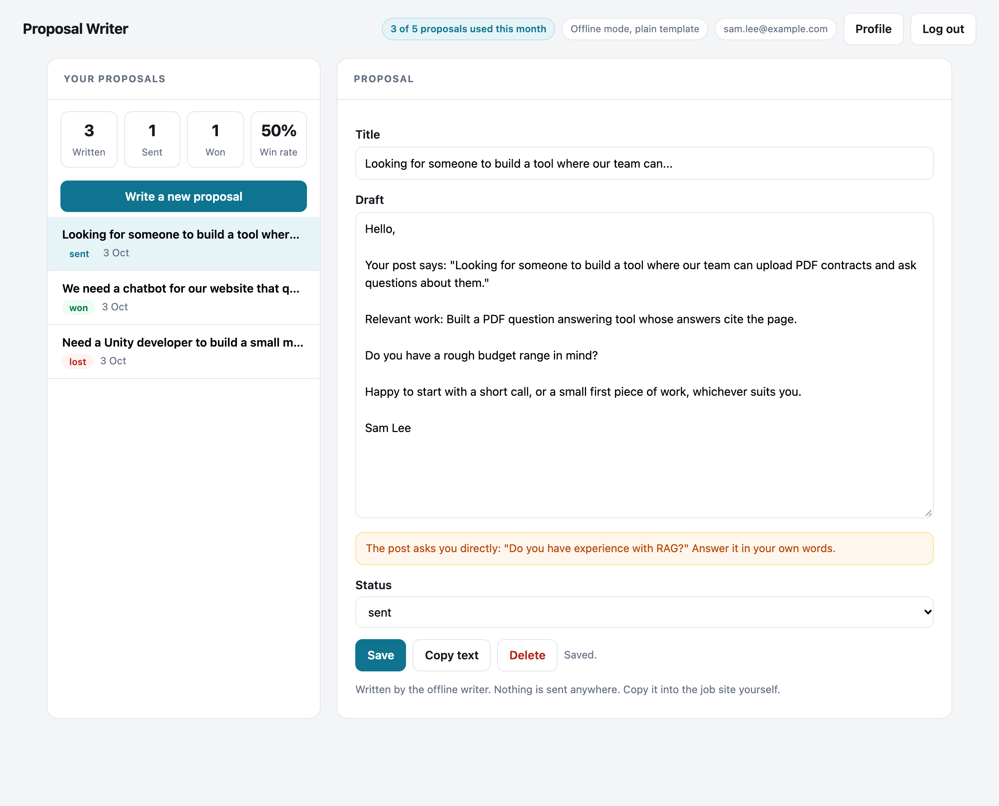
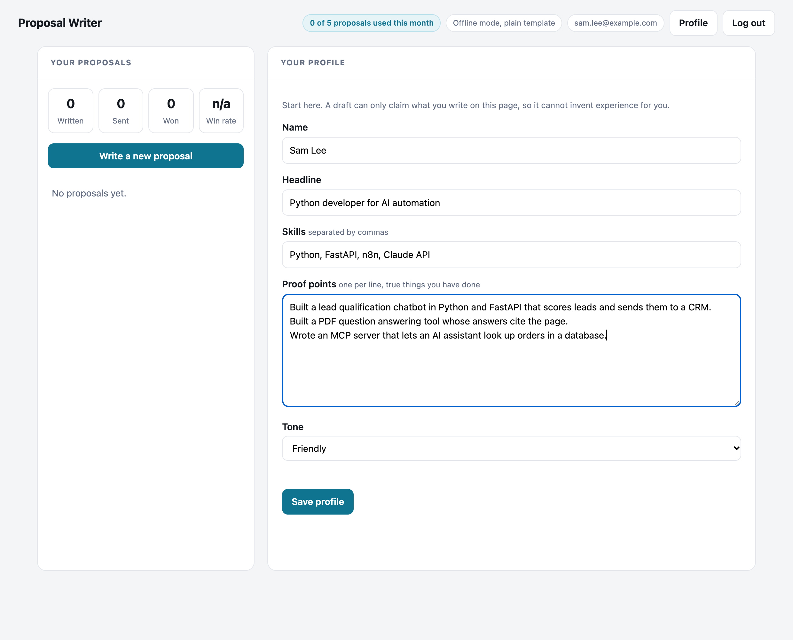

# Proposal Writer

A small SaaS product for freelancers. You describe yourself once, paste a job post, and get a first draft of a proposal that you edit and copy. Each proposal is tracked as draft, sent, won or lost, so the page shows your win rate.

It is built as a real product MVP rather than a single script: accounts, private data for each customer, a monthly allowance, a usage meter and an AI feature with checks around it. The one rule at the centre is that **a draft can only claim what you wrote in your profile**. It cannot invent clients, results or experience for you.

The people, jobs and proposals in the screenshot are invented.

## What it looks like

A draft for a PDF tool job. The yellow note is a reminder that the post asked a direct question, which only the freelancer can answer:



The profile page, where the facts a draft is allowed to use are written down:



## What is in the product

- **Accounts.** Sign up and log in with email and password. Passwords are stored as salted scrypt hashes, never as text.
- **Private data.** Every proposal and profile belongs to one account, and every database query filters by that account. A test tries to read, edit and delete another account's proposal and expects a 404 each time.
- **A monthly allowance.** The free plan includes 5 proposals per calendar month, with a meter in the header. The check and the count happen in one database statement, so ten requests at once cannot take more than the limit. If writing fails on the server side, the allowance is given back.
- **The pipeline.** Mark each proposal draft, sent, won or lost. The page shows how many are written, sent and won, and a win rate that counts only decided proposals.
- **Two writers.** Offline needs no key. Claude, with a key, writes more naturally.

## The writers

**Offline.** A plain template. It quotes the first sentence of the job post, names the skills that appear in both the post and your profile, adds the proof points that match the post, asks one useful question (budget or deadline, only if the post is silent on it) and signs off in your tone. Where it has nothing honest to say it leaves that part out and tells you. If none of your proof points match the job, the draft has none, and the page says so.

**Claude.** If `ANTHROPIC_API_KEY` is set, Claude writes the draft from your profile and the post, using only the facts in the profile. The default model is `claude-haiku-4-5`, set with `PROPOSAL_MODEL`.

Checks on the Claude path:

- Any number in the draft that is in neither your profile nor the job post is flagged in yellow, for example "the draft mentions 40, which is not in your profile". The draft is kept, and you decide.
- A draft that is far too short or too long is rejected.
- The job post goes to the model inside tags with its text escaped, so it cannot close the tag and write its own instructions. The system prompt says the post is data, not instructions.
- If the API call fails or the reply is unusable, the offline writer answers, and the draft is labelled "offline (fallback)".

## How it is secured

| Concern | What is done |
|---|---|
| Passwords | Salted scrypt, with the cost settings stored in each hash. The same time is spent on an unknown email as on a wrong password, so response time does not reveal which emails have accounts |
| Sessions | A random token in an HttpOnly, SameSite=Lax cookie. Only a hash of the token is stored. Sessions expire after 7 days and logout deletes them on the server |
| Cross site forgery | Every change needs an `X-Requested-With` header, which a page on another site cannot add, on top of SameSite |
| Guessing passwords | 5 failed logins for an email locks it for 15 minutes, even for the right password |
| Other customers' data | Every query on proposals and profiles filters by the logged in account |
| Input | Length limits on every field, a fixed list of statuses and tones, and the job post is escaped before it reaches the model |

## Run it

Built and tested with Python 3.13 and FastAPI 0.142.

```bash
python3 -m venv .venv
source .venv/bin/activate
pip install -r requirements-dev.txt
python -m pytest                                  # 88 tests
python -m uvicorn app.main:create_app --factory   # then open http://127.0.0.1:8000
```

Settings, all optional:

| Variable | Default | Meaning |
|---|---|---|
| `ANTHROPIC_API_KEY` | none | Turns on Claude mode |
| `PROPOSAL_MODEL` | `claude-haiku-4-5` | Model used in Claude mode |
| `APP_DB` | `data/app.db` | SQLite file |
| `MONTHLY_LIMIT` | 5 | Proposals per account per month |
| `SESSION_DAYS` | 7 | How long a login lasts |
| `COOKIE_SECURE` | 0 | Set to 1 when the site is served over HTTPS |

## API

| Request | What it does |
|---|---|
| `POST /api/signup`, `POST /api/login`, `POST /api/logout` | Account and session |
| `GET /api/me` | Who is logged in, with the usage meter |
| `GET /api/profile`, `PUT /api/profile` | The facts a draft may use |
| `POST /api/proposals/generate` | Write a draft from a job post. Uses one from the allowance |
| `GET /api/proposals`, `GET /api/proposals/{id}` | The list and one proposal |
| `PUT /api/proposals/{id}` | Edit the title or text, or set the status |
| `DELETE /api/proposals/{id}` | Delete a proposal. The month's allowance is not handed back |
| `GET /api/stats` | Counts by status and the win rate |

All changes need the header `X-Requested-With: proposal-writer`.

## Honest limitations

- **The Claude path has not been run against the live API for this project.** Its tests use a stand in client that returns prepared replies, which prove the request shape, the checks and the fallback. Try it with your own key before relying on it.
- **There is no billing.** The free allowance is enforced, but there is no upgrade path. Adding Stripe means products and prices, a checkout, and webhooks to change an account's plan. That is a separate piece of work and is not here.
- **No email features.** There is no email verification, no password reset and no two step login. All three need an email service and careful handling, so they are left out rather than done badly.
- **The figure check only looks at digits.** It catches an invented "40 clients" but not an invented "years of experience" written in words or a made up client name. Read every draft before sending.
- **Login locking is per email.** It stops guessing, but someone could also lock a known email out for 15 minutes. A larger service would also limit by address and add a challenge.
- **Offline drafts are plain.** They are a safe template and read like one. Claude mode reads better.
- **Nothing is sent anywhere.** You copy the draft into the job site yourself. There is no job site integration.
- **One server and one SQLite file.** That is fine for an MVP and one process. More traffic means a database server and shared sessions.
- **No account deletion or data export.** Real use, especially in the UK or EU, needs both.
- **Serve it over HTTPS and set `COOKIE_SECURE=1`.** The app does not do TLS itself.

## Project layout

```
app/main.py         routes, sessions, the CSRF check
app/repo.py         all database access, always filtered by account
app/security.py     password hashing and session tokens
app/profile.py      the facts a draft may use
app/writer.py       the draft shape and the invented figure check
app/writer_rules.py the offline writer
app/writer_llm.py   the Claude writer with checks and fallback
static/index.html   the whole interface
tests/              pytest suite
```
